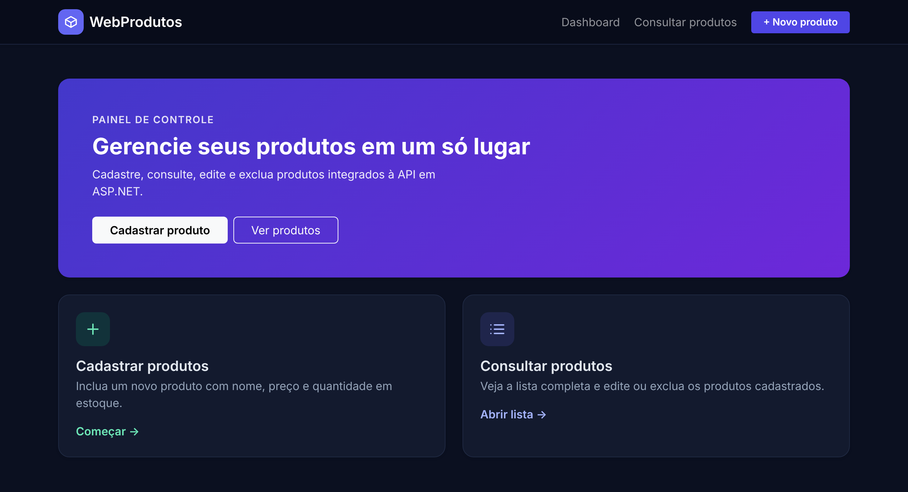
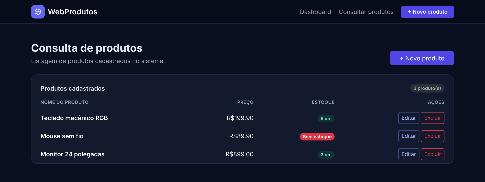
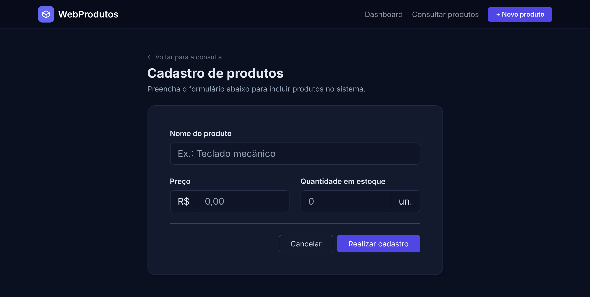

# WebProdutos

Front-end em **Angular** para o gerenciamento de produtos: cadastro, consulta, edição e exclusão integrados a uma API REST em ASP.NET Core. Interface com **Bootstrap 5.3** em tema escuro.

Projeto desenvolvido para a **Lista de Exercícios 01 – ASP.NET Core API / Angular** do curso **C#.NET WebDeveloper (Formação Fullstack)** da COTI Informática.

A API consumida por este projeto está no repositório **[Api.Produtos](https://github.com/Mnovis/Api.Produtos)**.

---

## Telas

### Dashboard



### Consulta de produtos



### Cadastro de produtos



---

## Funcionalidades

- **Cadastro** com formulário reativo e validação em tempo real (nome, preço e quantidade)
- **Consulta** em tabela, com o preço formatado em reais e um selo de "Sem estoque" para produtos zerados
- **Edição** com o formulário preenchido a partir da API
- **Exclusão** com confirmação antes de apagar
- Layout responsivo, com menu recolhível no celular

## Rotas

| Rota                   | Página                     | Chamada à API                                             |
| ---------------------- | -------------------------- | --------------------------------------------------------- |
| `/dashboard`           | Página inicial com atalhos | nenhuma                                                   |
| `/cadastro-produtos`   | Cadastro                   | `POST /api/v1/produtos`                                   |
| `/consulta-produtos`   | Consulta e exclusão        | `GET /api/v1/produtos` e `DELETE /api/v1/produtos/{id}`   |
| `/edicao-produtos/:id` | Edição                     | `GET /api/v1/produtos/{id}` e `PUT /api/v1/produtos/{id}` |

---

## Tecnologias

- Angular 22 (componentes standalone, Signals e control flow `@if` / `@for`)
- Reactive Forms com validadores
- HttpClient para a integração com a API
- Bootstrap 5.3 com o modo escuro (`data-bs-theme="dark"`)

## Estrutura

```
src/
├── app/
│   ├── components/
│   │   ├── layout/
│   │   │   └── navbar/
│   │   └── pages/
│   │       ├── dashboard/
│   │       ├── cadastro-produtos/
│   │       ├── consulta-produtos/
│   │       └── edicao-produtos/
│   ├── app.config.ts
│   └── app.routes.ts
├── environments/
│   ├── environment.ts
│   └── environment.development.ts
└── styles.css
```

---
